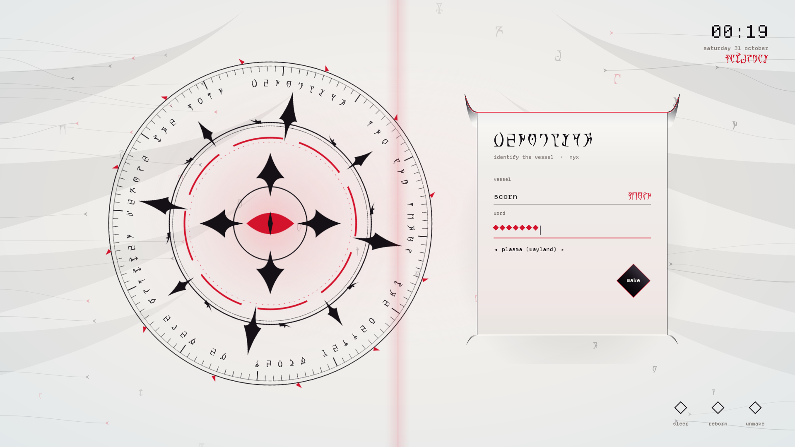
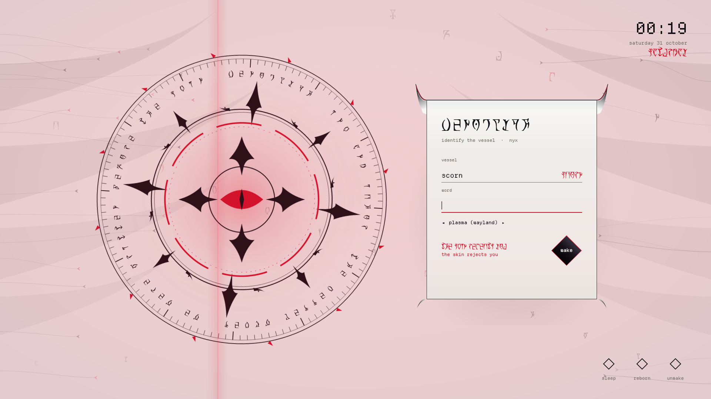

# Xenoglyph — SDDM Login

An alien-white SDDM login (Qt6): a living Daedric sigil beside a glossy finned card, a red eye that blinks, and passwords typed as red diamonds.



Xenoglyph is an alien-white, cybertribal look for KDE Plasma 6: pearl and bone surfaces, black tribal ink that sweeps into fins, horns and claws, a red ichor seam through everything, Daedric script, and motion everywhere.

## Features

- The living sigil: counter-turning rings of Daedric script around a red eye that pulses and blinks, glyphs drifting upward and a slow red scan beam.
- A glossy pearl card with an ink crown, a red ichor seam and a white bevel that flows into two tribal fins, with thin claws below.
- Your user name echoes in Daedric under the Latin one, and your password shows as red diamonds.
- A wrong password floods the screen red and shakes the card. The wake button is a glossy diamond that burns red on hover.
- Power controls named `sleep`, `reborn` and `unmake`. Fonts are bundled.



## Requirements

SDDM with the Qt6 greeter (`sddm-greeter-qt6`).

## Install

```bash
git clone https://github.com/numbpill3d/xenoglyph-sddm
cd xenoglyph-sddm && sudo ./install.sh
```

Or from the KDE Store: Extract to `/usr/share/sddm/themes/` and pick **Xenoglyph** in System Settings → Colors & Themes → Login Screen (SDDM).

## The rest of the suite

| piece | repo |
|---|---|
| Plymouth boot splash | [xenoglyph-plymouth](https://github.com/numbpill3d/xenoglyph-plymouth) |
| Global theme + splash screen | [xenoglyph-global](https://github.com/numbpill3d/xenoglyph-global) |
| Plasma style (panel, popups) | [xenoglyph-plasma](https://github.com/numbpill3d/xenoglyph-plasma) |
| Aurorae window decoration | [xenoglyph-aurorae](https://github.com/numbpill3d/xenoglyph-aurorae) |
| Floating runes (KWin script) | [xenoglyph-runes](https://github.com/numbpill3d/xenoglyph-runes) |
| Window open/close animation (KWin effect) | [xenoglyph-unfurl](https://github.com/numbpill3d/xenoglyph-unfurl) |
| Animated + still wallpaper | [xenoglyph-wallpaper](https://github.com/numbpill3d/xenoglyph-wallpaper) |
| Sigil clock widget | [xenoglyph-sigil](https://github.com/numbpill3d/xenoglyph-sigil) |
| Colour scheme | [xenoglyph-colors](https://github.com/numbpill3d/xenoglyph-colors) |
| Kvantum widget style | [xenoglyph-kvantum](https://github.com/numbpill3d/xenoglyph-kvantum) |
| Icon theme | [xenoglyph-icons](https://github.com/numbpill3d/xenoglyph-icons) |
| Konsole + kitty colours | [xenoglyph-konsole](https://github.com/numbpill3d/xenoglyph-konsole) |

Everything at once, with the generators: [xenoglyph](https://github.com/numbpill3d/xenoglyph).

## Tags

`xenoglyph` `kde` `kde-plasma` `plasma6` `light-theme` `white` `red` `cybertribal` `tribal` `alien` `daedric` `otherworldly` `animated` `sddm` `sddm-theme` `login-screen` `qt6` `qml`

## Credits and licence

By splicer scorn (voidrane). GPL-3.0-or-later.
Fonts: OMW Ayembedt (Daedric, SIL OFL 1.1) and Departure Mono by Helena Zhang (SIL OFL 1.1), bundled with their licences.
